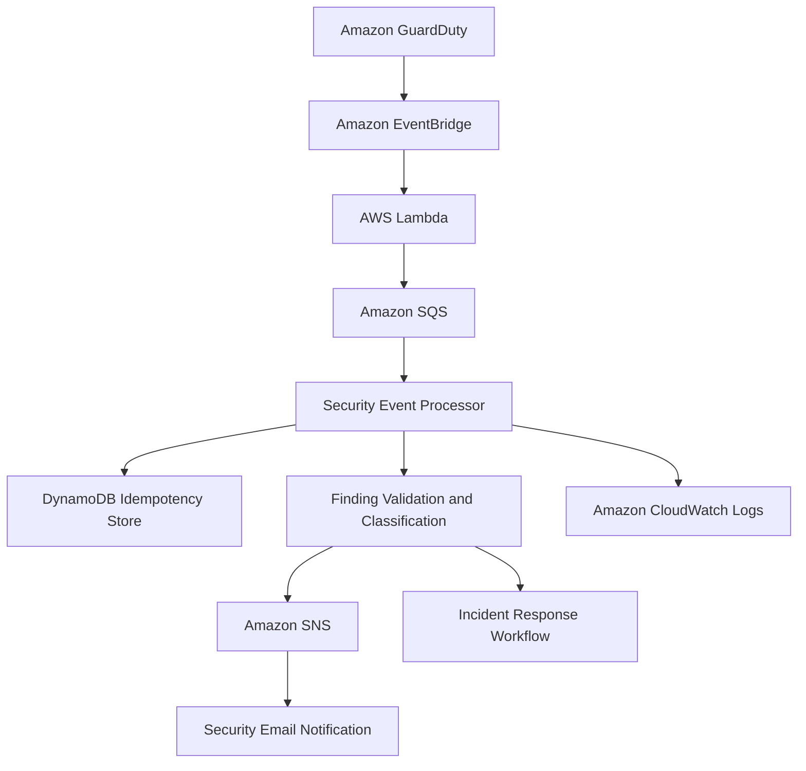

# Real-Time AWS Threat Detection & Automated Response Pipeline

An AWS-native, event-driven security detection and response pipeline that processes Amazon GuardDuty findings, validates security events, prevents duplicate processing, and supports reliable incident notifications.

The project demonstrates practical cloud security engineering through event-driven architecture, serverless processing, idempotency, fault handling, and security response automation.

## Project Overview

Cloud environments continuously generate security findings that require timely investigation and response. Reliable processing is challenging because events may be delivered more than once, downstream services can become unavailable, and individual messages can fail during batch processing.

This project implements an automated threat detection and response workflow using AWS services and Python.

**Key objectives:**
- Detect suspicious activity using Amazon GuardDuty.
- Route security findings through Amazon EventBridge.
- Process security events using AWS Lambda and Amazon SQS.
- Prevent duplicate processing through DynamoDB-based idempotency.
- Deliver security notifications using Amazon SNS.
- Handle transient and permanent processing failures.
- Maintain traceability through structured logging and audit records.
- Support controlled and auditable incident response.

## Architecture

### Deployed AWS Architecture



### AWS Services

| AWS Service | Responsibility |
|---|---|
| Amazon GuardDuty | Threat detection and security findings |
| Amazon EventBridge | Event routing and triggering |
| AWS Lambda | Serverless event processing |
| Amazon SQS | Decoupled message processing |
| Amazon DynamoDB | Idempotency and processing state |
| Amazon SNS | Security notifications |
| Amazon CloudWatch | Application logs and operational monitoring |

## Implemented Security Features

### 1. Real-Time Threat Detection
- Processes security findings generated by Amazon GuardDuty.
- Validates incoming security event attributes.
- Supports event-driven security processing.
- Separates finding ingestion from downstream response actions.

### 2. Idempotent Event Processing
- DynamoDB-backed idempotency implementation.
- Conditional writes to prevent duplicate processing.
- Stable event identity for deduplication.
- Lease-based processing coordination.
- Prevention of active lease theft.
- Reclamation of expired processing leases.
- Owner validation before marking or releasing leases.

### 3. Reliable SQS Message Processing
- SQS-based event processing.
- Partial batch failure handling.
- Separate retryable and permanent processing exceptions.
- Individual message failure handling.
- Controlled retry behavior for transient failures.

### 4. Security Notification Workflow
- Processes validated security findings.
- Supports security alert notification through Amazon SNS.
- Separates event processing from notification delivery.
- Provides a foundation for security operations workflows.

### 5. Failure Handling and Resilience
- Distinguishes transient infrastructure failures from permanent processing failures.
- Handles duplicate event deliveries.
- Supports lease expiration and recovery.
- Prevents completed events from being unnecessarily processed again.

### 6. Controlled Incident Response
High-impact containment actions should be isolated from notification logic.

The response design emphasizes:
- Least-privilege IAM permissions.
- Explicit authorization for containment.
- Approval requirements for high-impact actions.
- Auditable response decisions.
- Safe handling of failed response operations.

## Technology Stack

| Category | Technology |
|---|---|
| Programming Language | Python |
| Threat Detection | Amazon GuardDuty |
| Event Routing | Amazon EventBridge |
| Serverless Compute | AWS Lambda |
| Message Queue | Amazon SQS |
| Idempotency Store | Amazon DynamoDB |
| Notifications | Amazon SNS |
| Logging | Amazon CloudWatch |
| Testing | Pytest |
| Cloud Platform | Amazon Web Services |

## Project Structure

The implementation is organized around security event processing, idempotency, message handling, and automated testing.

```text
guardduty-threat-pipeline/
│
├── src/
│   ├── policy.py
│   ├── handler.py
│   ├── sqs_handler.py
│   └── idempotency.py
│
├── tests/
│   ├── test_policy.py
│   ├── test_handler.py
│   ├── test_idempotency.py
│   ├── test_duplicate_processing.py
│   ├── test_dynamodb_idempotency.py
│   └── test_sqs_handler.py
│
├── requirements.txt
├── README.md
└── .gitignore
```

*Update module names and folders to match the deployed repository.*

## Reliability and Security Engineering Decisions

### Idempotency and Duplicate Prevention

Event-driven systems can deliver the same message multiple times. Without deduplication, repeated processing can create duplicate alerts or trigger repeated downstream actions.

The pipeline uses stable event identifiers and conditional idempotency operations to prevent unnecessary duplicate processing.

### Lease-Based Processing

Processing leases coordinate workers handling the same event.

- Active leases cannot be stolen.
- Expired leases can be reclaimed.
- Only the lease owner can mark or release a lease.

This supports recovery when a worker fails before completing processing.

### Retryable vs. Permanent Failures

The system distinguishes between:

- **Retryable failures:** Temporary infrastructure or dependency failures.
- **Permanent failures:** Invalid or unsupported event data.

This prevents unnecessary retries for events that cannot succeed without correction.

### Operational Observability

A production deployment should monitor:
- Finding processing success and failure rates.
- SQS queue depth and message age.
- Dead-letter queue activity.
- Lambda errors and duration.
- DynamoDB throttling and conditional-write failures.
- End-to-end alert delivery latency.

## Testing and Validation

The project has previously reached **33 passing tests**.

Test coverage includes:

| Test Area | Validation |
|---|---|
| Security policy | Finding evaluation and policy decisions |
| Event handler | Security event processing |
| Idempotency | Duplicate event prevention |
| Completed events | Duplicate processing skipped |
| DynamoDB | Conditional writes and lease management |
| Lease recovery | Expired lease reclamation |
| Ownership | Lease owner validation |
| SQS | Partial batch failure handling |
| Error handling | Retryable and permanent failures |

Run the test suite:

```powershell
pytest -v
```

## Future Enhancements

- Approval-controlled EC2 isolation and containment.
- Expanded GuardDuty finding classification.
- Security incident dashboards.
- CloudWatch alarms for operational thresholds.
- End-to-end integration and failure-injection testing.
- Enhanced incident audit trails.
- Automated security response playbooks.

## Project Objective

Demonstrate practical AWS security engineering by building a deployed, event-driven threat detection and response system with reliable event processing, duplicate prevention, fault handling, and security notification capabilities.

**Focus Areas:** AWS Security · Amazon GuardDuty · Threat Detection · Incident Response · Event-Driven Architecture · Python · AWS Lambda · SQS · DynamoDB · SNS · Idempotency · Security Automation

## Author

**Koushika Budda**

[GitHub](https://github.com/bkoushika-24)
